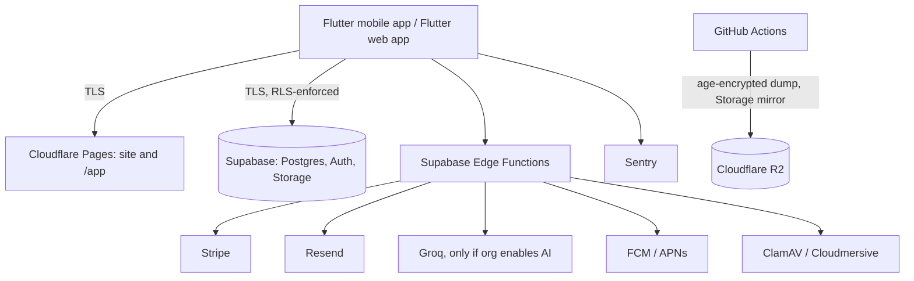

# Venue Wrangler SOC 2 Compliance Program

## Overview

This directory holds Venue Wrangler's security and compliance documentation. **Venue Wrangler has not undergone a SOC 2 examination.** The documents describe the controls that actually operate today, flag what does not (status column in the controls matrix), and keep a roadmap. They are a self-assessment for internal use and customer due diligence, not an attestation or a certification claim.

---

## Trust Services Criteria considered

| Criteria | Position |
|---|---|
| **Security (Common Criteria)** | Partially implemented: database-enforced tenant isolation (RLS) and CI testing exist; change control, MFA enforcement, access reviews and monitoring are gaps. |
| **Availability** | Partial: nightly encrypted logical backups to Cloudflare R2 and a Storage mirror; restore not yet verified, PITR not enabled, no DR drills performed. |
| **Confidentiality** | Partial: tenant isolation, role-based access, malware scanning of uploads. |
| **Privacy** | Partial: one privacy policy (draft for counsel review), self-deletion, retention schedule. |

---

## Document library

1. **[SOC 2 Controls Matrix](./soc2-controls-matrix.md)**: criteria mapped to controls with Status (Implemented / Partial / Planned / Not operated) and evidence pointers.
2. **[Information Security Policy](./information-security-policy.md)**
3. **[Access Control & Authentication Policy](./access-control-policy.md)**
4. **[Incident Response Plan](./incident-response-plan.md)**
5. **[Business Continuity & Disaster Recovery](./business-continuity-disaster-recovery.md)**
6. **[Vendor Management Policy](./vendor-management-policy.md)**: the real subprocessor list.
7. **[Data Retention & Disposal Policy](./data-retention-disposal-policy.md)**
8. **[Prowler guide](./prowler-guide.md)**: legacy; the scan is manual-only and targets GCP/AWS that the product no longer uses.

Related: `../security/hosted-auth-settings.md` (manual hosted settings), `../security/secrets-handling.md` (secrets and rotation), `../production-operations.md` (runbooks), `../privacy-policy.md`.

---

## Architecture summary

### Key technical controls

* **Tenant isolation**: Postgres row-level security with membership resolved live; helpers in the unexposed `app_hidden` schema (`docs/tenant-isolation.md`). Tested by pgTAP in CI.
* **Audit trail**: `public.audit_log`, retained 365 days (time-entry corrections 3 years).
* **Headers**: strict CSP for `/app` pinned to the production Supabase host; marketing site scripts allowed by hash only.
* **CI**: tests, CodeQL (JS/TS), pgTAP, Deno checks with a frozen lockfile, `npm audit` gate, SHA-pinned Actions.

---

## Known gaps (also in the matrix)

* `main` has no branch protection or required reviews; there is no staging environment; migrations are applied by hand.
* MFA is available but not enforced.
* Backup restore has not yet been verified; PITR is off; no DR exercise has been performed.
* No vendor DPAs/SOC 2 reports are on file; no access reviews or annual risk assessment have been performed.
